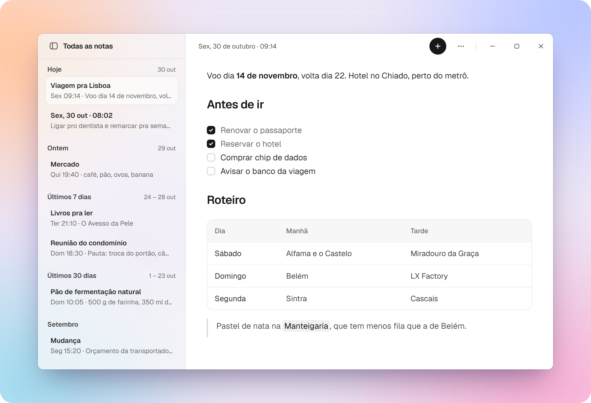
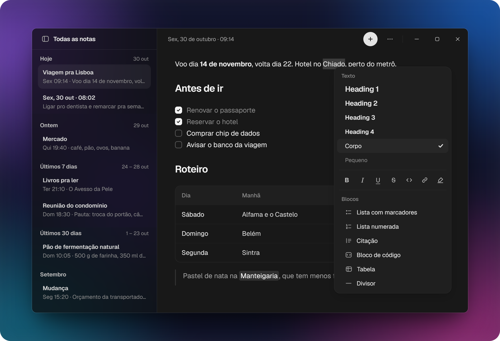
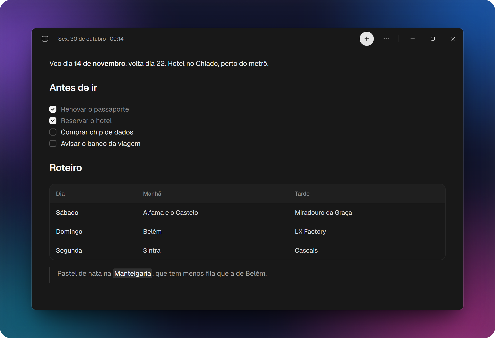

# Meet Noter 📝

App de notas pessoal pra Windows, inspirado no Notes do Mac. Cada nota é um arquivo Markdown em `Documentos\Notas`, que pode ser aberto em qualquer editor

## Instalar

Baixe o `Noter-Setup-x.y.z.exe` da [última versão](https://github.com/juanssilveira/noter/releases/latest) e rode. O instalador não tem assinatura de código, então o Windows pode mostrar o aviso do SmartScreen na primeira vez: clique em "Mais informações" e depois em "Executar assim mesmo". 

Depois disso, o app atualiza sozinho.

## O que tem

- Lista agrupada por data: Hoje, Ontem, Últimos 7 dias, Últimos 30 dias e meses
- Títulos automáticos (mas editáveis), listas, checklist, tabela, citação, código e destaque, com os atalhos de Markdown ao digitar (`# `, `- `, `[ ] `, `> `)
- Formatação rápida pelo clique direito no texto
- Tema claro e escuro, com efeito acrílico opcional na lista
- Autosave

#### Dark mode e modo Acrylic (dá pra desativar)

Com a lista escondida, sobra só a nota (TDAH mode 😅)

## Desenvolvimento

Ainda sem setup de contribuição, atualizações em breve ⏳